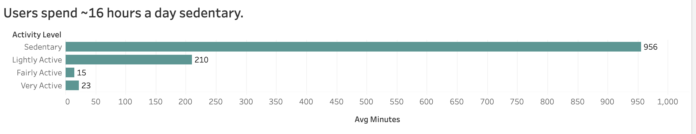
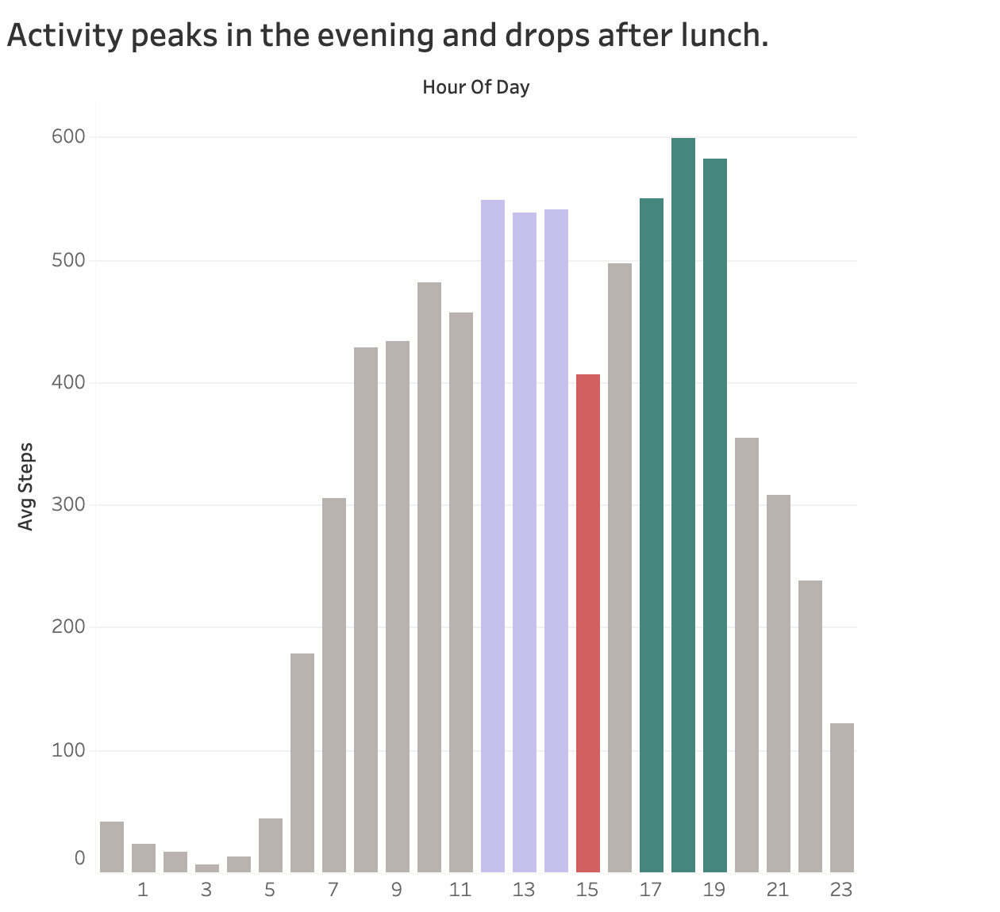

# 🌿 Bellabeat Data Analysis Case Study
**Google Data Analytics Professional Certificate Capstone**

---

## 📌 Project Overview
This project is a portfolio case study completed as part of the **Google Data Analytics Professional Certificate**. In this scenario, I act as a junior data analyst on the marketing analytics team at **Bellabeat**, a high-tech manufacturer of health-focused wellness smart devices designed specifically for women.

Urška Sršen, Cofounder and Chief Creative Officer of Bellabeat, believes that analyzing consumer smart device fitness data can unlock new growth opportunities for the company. This analysis focuses on non-Bellabeat smart device data (Fitbit) to uncover consumer usage habits and translate those patterns into actionable marketing recommendations for Bellabeat's executive team.

---

## 🎯 Business Task
Analyze public consumer smart-device fitness data (specifically tracking daily activity, intensity, sedentary behavior, and sleep patterns) to uncover usage habits and behavioral trends, map those insights onto Bellabeat's product ecosystem (primarily the **Leaf** tracker and **Bellabeat App**), and deliver actionable, data-driven marketing recommendations that optimize user engagement, customer acquisition, and brand positioning in the global women's wellness market.

---

## 👥 Key Stakeholders
* **Urška Sršen:** Bellabeat Cofounder and Chief Creative Officer
* **Sando Mur:** Mathematician and Bellabeat Cofounder (Executive Team Member)
* **Bellabeat Marketing Analytics Team:** Core analytics team guiding data-driven marketing campaigns

---

## 🧭 Analysis Framework
The project follows the six stages of the Google Data Analysis process:

1. **Ask:** Define business questions, identify key objectives, and align with stakeholder goals.
2. **Prepare:** Collect and store data, evaluate credibility and bias using the ROCCC framework.
3. **Process:** Clean, transform, validate, and document data preparation to ensure integrity.
4. **Analyze:** Aggregate, organize, and perform exploratory data analysis (EDA) to uncover trends.
5. **Share:** Design executive-level data visualizations and communicate findings effectively.
6. **Act:** Deliver actionable, high-level marketing strategies and product recommendations.

---

## 🛠️ Tools & Technologies
* **Data Storage & Cleaning:** Google BigQuery (SQL)
* **Data Visualization:** Tableau Public
* **Documentation & Version Control:** Markdown, Git, GitHub

---

## 📂 Data Sources & Architecture
The primary dataset used for this case study is the **FitBit Fitness Tracker Data** (publicly available via [Kaggle](https://www.kaggle.com/datasets/arashnic/fitbit) and stored under a public domain dedication).

* **Source Entity:** Collected by Mobius via Amazon Mechanical Turk.
* **Original Study Citation:** Furberg, R., Brinton, J., Keating, M., & Ortiz, A. (2016). *Crowdsourced Fitbit datasets 03.12.2016-05.12.2016* [Data set]. Zenodo.
* **Collection Window:** April 12, 2016 – May 12, 2016 (31-day monitoring window).
* **Sample Size:** 33 unique eligible Fitbit users who consented to the submission of personal tracker data.

### Core Datasets Selected for Analysis
While the raw repository contains 18 separate CSV files at varying granularities (seconds, minutes, hours, days), the following three tables were selected to answer Bellabeat's executive business questions:

| Table Name | Primary Keys | Key Attributes & Metrics | Business Relevance |
| :--- | :--- | :--- | :--- |
| **`daily_activity`**<br>*(dailyActivity_merged.csv)* | `Id`, `ActivityDate` | `TotalSteps`, `TotalDistance`, `VeryActiveMinutes`, `FairlyActiveMinutes`, `LightlyActiveMinutes`, `SedentaryMinutes`, `Calories` | Evaluates overall daily movement, energy expenditure, intensity breakdown, and baseline activity habits. |
| **`sleep_day`**<br>*(sleepDay_merged.csv)* | `Id`, `SleepDay` | `TotalSleepRecords`, `TotalMinutesAsleep`, `TotalTimeInBed` | Analyzes rest patterns, sleep duration adequacy, and time spent awake in bed. |
| **`hourly_steps`**<br>*(hourlySteps_merged.csv)* | `Id`, `ActivityHour` | `StepTotal` | Uncovers intraday patterns to identify peak movement intervals and sluggish periods throughout the day. |

### 📁 Repository Structure

```
README.md                      ← project write-up (this file)
sql/
  bellabeat_full_analysis.sql  ← full BigQuery script: integrity checks, cleaning, analysis
  tableau_exports.sql          ← queries that produce the Tableau-ready summary tables
data/
  raw/                         ← original Fitbit CSVs (April 12 – May 12, 2016)
  tableau/                     ← summary tables exported from BigQuery for the dashboard
```

* [`data/raw/`](data/raw/) contains the three original CSV files listed above.
* [`data/tableau/`](data/tableau/) contains the five summary tables used to build the Tableau dashboard.
* The cleaned tables (`sleep_day_clean`, `hourly_steps_clean`) are not stored as files. They can be recreated by running [`bellabeat_full_analysis.sql`](sql/bellabeat_full_analysis.sql).

---

## ⚠️ Data Limitations & Bias Analysis (ROCCC)
* **Reliable (Low):** Small sample size ($N = 33$ unique users in daily activity; $N = 24$ in sleep logs).
* **Original (Low):** Crowdsourced via Amazon Mechanical Turk rather than direct first-party telemetry.
* **Comprehensive (Low):** No demographic information (gender, age, location, occupation). Since Bellabeat builds for women, insights must be evaluated as general human activity habits rather than female-specific physiology.
* **Current (Low):** Collected in Spring 2016. Consumer wearable hardware and habits have evolved.
* **Cited (Medium):** Well-documented methodology via Zenodo under CC0: Public Domain.

---

## ⚙️ Data Cleaning & Transformation (Process Phase)

The raw Fitbit datasets were audited and cleaned in **Google Cloud BigQuery** to resolve formatting errors, remove duplicate records, filter non-wear days, and engineer derived metrics. Cleaned results are saved as new tables so every analysis query runs on the same validated data. The full script is available in [`bellabeat_full_analysis.sql`](sql/bellabeat_full_analysis.sql).

---

### 🛠️ Step-by-Step Data Cleaning Breakdown

#### 1. Checking for Duplicate Records (`sleep_day`)
Composite keys (`Id` + `SleepDay`) were checked to ensure one entry per user per day.

```sql
-- Check for duplicate daily logs
SELECT 
    Id, 
    SleepDay, 
    COUNT(*) AS duplicate_count
FROM `bellabeat_data.sleep_day`
GROUP BY Id, SleepDay
HAVING COUNT(*) > 1;
```

**Finding:** Identified 3 duplicate rows in `sleep_day` where the same user logged identical stats for the same date. These are removed in the next step so sleep hours are not double-counted.

#### 2. Cleaning Sleep Records & Calculating Time Awake in Bed (`sleep_day`)
The raw `SleepDay` column contained 12-hour AM/PM text strings. This query removes the duplicate rows, standardizes the date into `YYYY-MM-DD`, and creates a derived metric (`minutes_awake_in_bed`): the total time a user spent in bed without being asleep, including falling asleep, waking during the night, and lying in bed after waking.

```sql
CREATE OR REPLACE TABLE `bellabeat_data.sleep_day_clean` AS
WITH sleep_deduped AS (
    -- Remove the duplicate rows found in Step 1
    SELECT DISTINCT *
    FROM `bellabeat_data.sleep_day`
)
SELECT
    Id,
    -- Convert text to standard calendar date (YYYY-MM-DD)
    DATE(PARSE_TIMESTAMP('%m/%d/%Y %I:%M:%S %p', SleepDay)) AS sleep_date,
    TotalSleepRecords,
    TotalMinutesAsleep,
    TotalTimeInBed,
    -- Feature engineering: time in bed minus time asleep = time awake in bed
    (TotalTimeInBed - TotalMinutesAsleep) AS minutes_awake_in_bed
FROM sleep_deduped;
```

A follow-up check confirmed the cleaned table contains no duplicate `Id` + `sleep_date` pairs.

#### 3. Parsing Intraday Intervals (`hourly_steps`)
Raw text timestamps were converted to true timestamps to extract the integer hour (0 to 23). This enables grouping movement patterns across a 24-hour day to pinpoint peak activity hours.

```sql
CREATE OR REPLACE TABLE `bellabeat_data.hourly_steps_clean` AS
WITH formatted_hours AS (
    SELECT
        Id,
        -- Step 1: Parse string into a valid timestamp
        PARSE_TIMESTAMP('%m/%d/%Y %I:%M:%S %p', ActivityHour) AS activity_time,
        StepTotal
    FROM `bellabeat_data.hourly_steps`
)
SELECT
    Id,
    activity_time,
    -- Step 2: Extract hour integer (0 to 23)
    EXTRACT(HOUR FROM activity_time) AS hour_of_day,
    StepTotal
FROM formatted_hours;
```

#### 4. Filtering Unworn Tracker Days (`daily_activity`)
Smart tracker datasets often contain days where the tracker was uncharged or left on a nightstand. Days with zero recorded steps were excluded during aggregation.

```sql
-- Filter out zero-step days during aggregation
SELECT *
FROM `bellabeat_data.daily_activity`
WHERE TotalSteps > 0;
```

**Why this matters:** A day with `TotalSteps = 0` almost always reflects a tracker that was not worn rather than true human behavior. Filtering these days prevents artificial deflation of daily activity and calorie averages.

---

## 📊 Exploratory Data Analysis & Key Insights (Analyze Phase)

Using Google BigQuery, exploratory queries were run on the cleaned datasets to identify consumer habits, sleep behaviors, and intraday activity trends. All figures below come from the April 12 – May 12, 2016 dataset after cleaning (863 worn days, 410 unique sleep records, 33 users).

---

### 1. Daily Activity Baseline: The Sedentary Reality

```sql
-- Overall daily averages (steps, active minutes, sedentary time, calories)
SELECT 
    ROUND(AVG(TotalSteps), 0) AS avg_daily_steps,
    ROUND(AVG(VeryActiveMinutes), 0) AS avg_very_active_mins,
    ROUND(AVG(FairlyActiveMinutes), 0) AS avg_fairly_active_mins,
    ROUND(AVG(LightlyActiveMinutes), 0) AS avg_lightly_active_mins,
    ROUND(AVG(SedentaryMinutes), 0) AS avg_sedentary_mins,
    ROUND(AVG(Calories), 0) AS avg_daily_calories
FROM `bellabeat_data.daily_activity`
WHERE TotalSteps > 0;  -- exclude days the tracker was not worn
```

* **Average Daily Steps:** ~8,319 steps per worn day, still short of the widely cited 10,000-step benchmark.
* **Time Allocation Breakdown:**
  * **Sedentary Time:** ~956 minutes (~16 hours/day), by far the largest share of tracked time.
  * **Lightly Active Time:** ~210 minutes (~3.5 hours/day).
  * **Fairly Active Time:** ~15 minutes/day.
  * **Very Active Time:** ~23 minutes/day.
* **Key Finding:** Users spend most of their day sedentary, and light everyday movement makes up nearly all of their activity. Very active time accounts for only ~1.6% of the day (23 of 1,440 minutes), suggesting a population of casual movers rather than fitness enthusiasts.

---

### 2. Sleep Efficiency & Rest Patterns

```sql
-- Sleep averages from the de-duplicated sleep table
SELECT 
    ROUND(AVG(TotalMinutesAsleep) / 60, 1) AS avg_sleep_hours,
    ROUND(AVG(TotalTimeInBed) / 60, 1) AS avg_time_in_bed_hours,
    ROUND(AVG(minutes_awake_in_bed), 0) AS avg_minutes_awake_in_bed
FROM `bellabeat_data.sleep_day_clean`;
```

* **Average Sleep Duration:** ~7.0 hours per night, at the lower end of the standard 7–9 hour recommendation.
* **Average Time in Bed:** ~7.6 hours per night.
* **Time Awake in Bed:** ~39 minutes per night on average. However, plotting each night shows that **most nights are highly efficient**: time asleep is close to time in bed. The average is pulled up by a minority of restless nights with large gaps, plus a few extreme records of ~16 hours in bed.
* **Adherence Gap:** While 33 users logged daily activity, only 24 (~73%) tracked sleep at all, suggesting friction with wearing a wristband overnight.

---

### 3. Intraday Movement Patterns (Hourly Distribution)

```sql
-- Average steps for each hour of the day
SELECT 
    hour_of_day,
    ROUND(AVG(StepTotal), 0) AS avg_steps
FROM `bellabeat_data.hourly_steps_clean`
GROUP BY hour_of_day
ORDER BY avg_steps DESC;
```

Analyzing hourly step distributions revealed distinct daily behavioral cycles:
* **Morning Ramp-Up:** Movement is minimal overnight and climbs steadily from 7:00 AM.
* **Lunchtime Surge (12:00 PM – 3:00 PM):** A sustained block of high activity around midday.
* **Afternoon Dip (3:00 PM – 4:00 PM):** Steps drop sharply for about one hour, to roughly 25% below the surrounding hours.
* **Evening Peak (5:00 PM – 8:00 PM):** The most active window of the day, with the single busiest hour at 6:00–7:00 PM. This likely reflects commutes, workouts, and evening walks.
* **Wind-Down:** Activity falls steadily after 8:00 PM.

---

### 4. Steps vs. Calories Burned

* Plotting all 863 worn days shows a clear positive relationship: **days with more steps burn more calories**.
* The spread around the trend line is wide, though. Users with similar step counts can burn very different amounts of calories, because body size and resting metabolism also play a large role. A handful of days with very low calorie counts likely reflect partial-day or device-error records.

---

### 5. User Segmentation

#### A. Activity Level Breakdown (Based on Average Daily Steps)
Each user's average daily steps (excluding zero-step days) was used to place them in one of four activity categories:

```sql
-- Categorize each user by average daily steps
SELECT 
    Id,
    ROUND(AVG(TotalSteps), 0) AS avg_daily_steps,
    CASE 
        WHEN AVG(TotalSteps) < 5000  THEN 'Sedentary'
        WHEN AVG(TotalSteps) < 7500  THEN 'Lightly Active'
        WHEN AVG(TotalSteps) < 10000 THEN 'Fairly Active'
        ELSE 'Very Active'
    END AS activity_category
FROM `bellabeat_data.daily_activity`
WHERE TotalSteps > 0
GROUP BY Id
ORDER BY avg_daily_steps DESC;
```

> Sequential `<` checks are used instead of `BETWEEN` because `AVG()` returns decimals. With `BETWEEN 5000 AND 7499`, an average like 7,499.6 would fall through the gaps and be mislabeled.

**Results:**
1. **Sedentary (< 5,000 steps/day):** ~21% of users (7 of 33).
2. **Lightly Active (5,000 – 7,499 steps/day):** ~27% of users (9 of 33).
3. **Fairly Active (7,500 – 9,999 steps/day):** ~30% of users (10 of 33).
4. **Very Active (10,000+ steps/day):** ~21% of users (7 of 33).

Just under half of users (16 of 33, ~48%) average fewer than 7,500 steps per day, and only about 1 in 5 reaches 10,000.

#### B. Device Tracking Adherence (Consistency Over 31 Days)
Users were grouped by the number of days with logged activity records:

```sql
-- Group users by how many days they logged activity
SELECT 
    Id,
    COUNT(ActivityDate) AS total_logged_days,
    CASE 
        WHEN COUNT(ActivityDate) >= 25 THEN 'High Usage (25-31 days)'
        WHEN COUNT(ActivityDate) >= 15 THEN 'Moderate Usage (15-24 days)'
        ELSE 'Low Usage (< 15 days)'
    END AS device_usage_segment
FROM `bellabeat_data.daily_activity`
GROUP BY Id
ORDER BY total_logged_days DESC;
```

**Results:**
* **High Usage (25–31 logged days):** ~88% of users (29 of 33).
* **Moderate Usage (15–24 logged days):** ~9% of users (3 of 33).
* **Low Usage (< 15 logged days):** ~3% of users (1 of 33).

**Key Finding:** Daytime tracking adherence is excellent, with nearly 9 in 10 users logging activity almost every day. The real engagement gap is **overnight**: more than a quarter of users never tracked sleep.

---

## 📈 Data Visualization (Share Phase)


### 📊 Daily Time Allocation by Activity Level





### 📈 Average Steps by Hour of Day with the lunch surge, afternoon dip, and evening peak highlighted*


<p align="left">
  
</p>


**3. Time asleep vs. time in bed for each night**


**4. Steps vs. calories burned for each worn day**


**5. Users by activity level segment**


**6. Users by device usage segment**


The data behind each chart is in [`data/tableau/`](data/tableau/), produced by [`tableau_exports.sql`](sql/tableau_exports.sql).

🔗 **Interactive dashboard:** [View on Tableau Public](https://public.tableau.com/views/BellabeatDataAnalysis_17932507769210/Dashboard1)

---

## 💡 Strategic Marketing Recommendations (Act Phase)

Based on these behavioral insights, Bellabeat has an opportunity to position its products (particularly the **Bellabeat Leaf** and **Bellabeat App**) to solve these specific user friction points.

### 1. Position the Bellabeat Leaf as the "Effortless 24/7 Sleep Companion"
* **The Problem:** ~88% of users logged activity almost every day, yet ~27% (9 of 33) never tracked their sleep. Users are happy to wear a tracker during the day, but wrist-worn devices are often uncomfortable overnight.
* **The Strategy:** Highlight that the **Leaf** can be clipped to sleepwear, worn as a lightweight pendant, or attached as a discreet accessory. Market its long battery life (no nightly charging cables) to close the gap between daytime and overnight tracking.

### 2. Use In-App Sleep Insights to Support Restless Nights
* **The Problem:** Most nights are efficient, but a meaningful minority show large gaps between time in bed and time asleep, raising the average to ~39 minutes awake in bed per night.
* **The Strategy:** Rather than generic sleep advice for everyone, the Bellabeat App should detect restless nights and respond personally: gentle "wind-down" reminders before the user's usual bedtime, plus guided meditations, breathwork, and ambient soundscapes within the Bellabeat membership.

### 3. Time Movement Prompts to Daily Rhythms
* **The Problem:** Activity dips sharply around 3:00–4:00 PM, and the most active window of the day is 5:00–8:00 PM.
* **The Strategy:** Send a subtle, customizable vibration reminder around 3:00 PM to prompt a brief 5-minute movement or hydration break, framed as a focus-boosting ritual rather than a fitness demand. Use the 5:00–8:00 PM peak for encouraging content, such as goal progress, streaks, and evening walk challenges, when users are already most motivated to move.

### 4. Tiered Habit Coaching Instead of the 10,000-Step Hurdle
* **The Problem:** Just under half of users (~48%) average fewer than 7,500 steps per day, and only ~21% reach 10,000. Imposing rigid 10,000-step goals can lead to frustration and device abandonment.
* **The Strategy:** In marketing campaigns and onboarding flows, emphasize holistic wellness and achievable micro-goals (e.g., "Add 1,000 steps to your natural daily rhythm") rather than aggressive athletic metrics.
