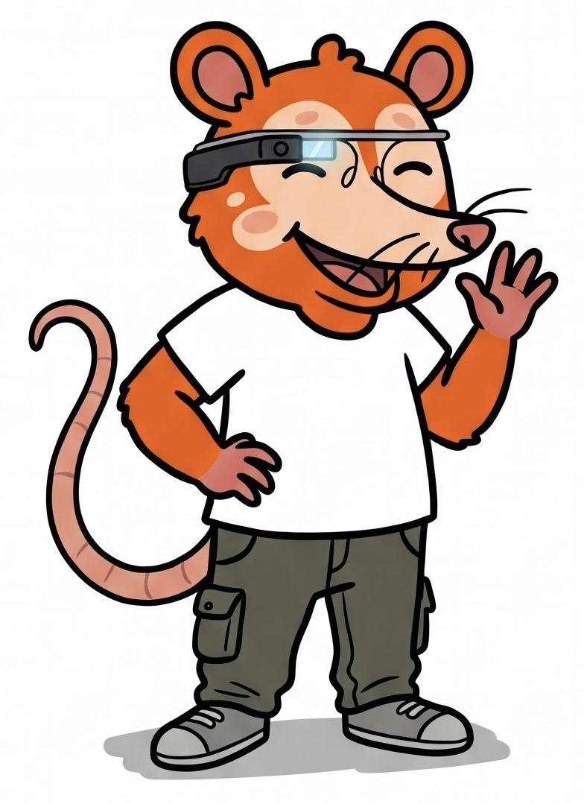

# 🦝 Project Mascot: Barnaby the Possum

  

Meet the official mascot for the data analytics projects! Barnaby is an optimistic, tech-savvy orange possum equipped with Google Glass, helping present data insights and dashboards cleanly and clearly.
